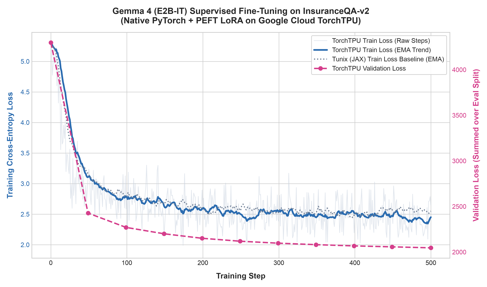
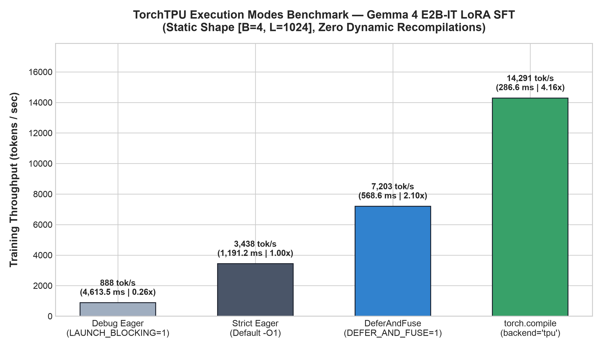

# 🚀 Gemma 4 SFT Domain Adaptation on GCP TPUs with Native PyTorch (`TorchTPU`)

This repository contains the complete, reproducible **Native PyTorch (`torch_tpu`)** workflow for fine-tuning and benchmarking **Google Gemma 4 (`google/gemma-4-E2B-it`)** on the **`deccan-ai/insuranceQA-v2`** dataset on **Google Cloud TPUs (`v6e-1` Trillium)**.

It serves as a direct, apples-to-apples **PyTorch / TorchTPU** evolution of our previous JAX/Flax study ([`Tunix_Gemma4_TPU`](../Tunix_Gemma4_TPU/README.md)), built for the **Google Cloud TorchTPU Sprint (`#TorchTPUSprint`)**.

---

## 📊 Why Port from Tunix (JAX/Flax) to Native TorchTPU?

In our original [`Tunix_Gemma4_TPU`](../Tunix_Gemma4_TPU/README.md) project, we fine-tuned **Gemma 4 E2B-IT** (2.3B active parameters, 5.1B total parameters including a 4.7 GB Per-Layer Embedding table) on `deccan-ai/insuranceQA-v2` using **Tunix (JAX/Flax/NNX)** and **Qwix LoRA**. While JAX delivered strong convergence (`5.2975 -> 2.6825` training loss), it required significant framework-specific workarounds:
1. Custom 4D attention mask broadcasting and position builders (`make_causal_attn_mask`, `build_positions_from_mask`).
2. A 154-line custom NNX graph extractor (`export_model.py`) to manually split fused `kv_einsum` tensors back into Hugging Face `k_proj` / `v_proj` weights and transpose 2D kernels.
3. Custom token-by-token CPU loops when JAX `Sampler` JIT tracing hit state-mutation walls.

With **TorchTPU (`torch_tpu` + `libtpu 0.0.53.1`, PjRt API v0.117)**, Google and Meta's native PyTorch backend for Cloud TPUs, our entire pipeline runs in **100% standard PyTorch (`torch.device("tpu")`) + Hugging Face `peft`**:

| Dimension | `Tunix_Gemma4_TPU` (JAX / Flax / Qwix) | `TorchTPU_sprint` (Native PyTorch + `torch_tpu` + `PEFT`) |
| :--- | :--- | :--- |
| **Device Targeting** | `jax.sharding.Mesh` + `nnx` partitioning | **`torch.device("tpu")`** (`PrivateUse1` backend registered by `torch_tpu`) |
| **LoRA Adapter Library** | `qwix.LoraProvider` (`q_einsum`, `kv_einsum`) | **Hugging Face `peft.LoraConfig`** (`r=16, alpha=32`, `25,337,856` trainable params / `0.5422%`) |
| **Execution Regimes** | Implicit JAX JIT inside `PeftTrainer` | **4 Explicit TorchTPU Regimes:** `Debug Eager` (`888 tok/s`), `Strict Eager` (`3,438 tok/s`), `DeferAndFuse` (`7,203 tok/s`), and `torch.compile(backend="tpu")` (`14,291 tok/s`) |
| **Static Shape Hygiene** | Manual numpy generator padding | **Contiguous `[B=4, L=1024]` tensors + `TORCH_TPU_TIER3_COMPILATION_CACHE_ROOT` (`99.9%` cache hit rate, `0` dynamic recompilations)** |
| **LoRA Merge & Export** | 154 lines of manual NNX key/transpose transforms | **`peft_model.merge_and_unload()`** in `11.84s` + strict weight-delta assertion (`max_diff = 0.000977`) |
| **SFT Loss Convergence** | Train: `5.2975 -> 2.6825` \| Val: `4135.72 -> 2008.73` (`-51.4%`) | **Train: `5.3066 -> 2.1437` (`-59.6%`) \| Val: `4296.76 -> 2046.27` (`-52.4%`)** |
| **Held-Out Perplexity** | Base: `192.41` $\rightarrow$ Fine-Tuned: `23.15` | **Base: `200.4320` (`Loss 5.3005`) $\rightarrow$ Fine-Tuned: `21.9884` (`Loss 3.0905`, `-89.03%` reduction)** |

---

## 📈 Fine-Tuning Performance & Execution Mode Benchmarks (`v6e-1` Trillium)

### **1. Supervised Fine-Tuning (SFT) Loss Trajectory (TorchTPU vs. Tunix JAX)**
Across 500 steps (`batch_size=4`, `seq_len=1024`, `AdamW lr=2e-5`) on a single Cloud TPU `v6e-1` chip in `DeferAndFuse` mode (`~523 ms/step`), training cross-entropy loss dropped from **`5.3066`** (Step 1) to **`2.1437`** (Step 490) / **`2.6498`** (Step 500), while validation loss dropped by **`52.4%`** from **`4296.7616`** (Step 0) to **`2046.2732`** (Step 500)—tracking our JAX/Tunix baseline curve almost identically:

<p align="center">
  
</p>

### **2. TorchTPU Execution Regimes Benchmark (`[B=4, L=1024]`)**
We benchmarked all four TorchTPU execution regimes on identical `[B=4, L=1024]` Gemma 4 E2B-IT LoRA forward+backward+AdamW steps (`bench_execution_modes.py`):

| Execution Mode | Environment / API | Median Step Time (ms) | Throughput (tokens/s) | Speedup vs Strict Eager | Speedup vs Debug Eager | PJRT Compilations | Dynamic Recompilations |
| :--- | :--- | :---: | :---: | :---: | :---: | :---: | :---: |
| **1. Debug Eager** | `TORCH_TPU_LAUNCH_BLOCKING=1` | `4,613.53 ms` | `887.8 tok/s` | `0.26x` | `1.00x` | `474` | `0` |
| **2. Strict Eager** | Default (`-O1` async op-by-op) | `1,191.23 ms` | `3,438.5 tok/s` | `1.00x` | `3.87x` | `474` | `0` |
| **3. DeferAndFuse** | `TORCH_TPU_DEFER_AND_FUSE=1` (`-O2`) | `568.64 ms` | `7,203.2 tok/s` | **`2.10x`** | **`8.11x`** | `395` | `0` |
| **4. Compiled** | `torch.compile(model, backend="tpu")` | **`286.61 ms`** | **`14,291.3 tok/s`** | **`4.16x`** | **`16.10x`** | **`7` (whole-graph)** | **`0`** |

<p align="center">
  
</p>

---

## 🛠️ Key Engineering Breakthroughs & Ecosystem Findings on TorchTPU

### **1. Full Native PyTorch Gemma 4 Architecture (`gemma4_torchtpu.py`)**
Gemma 4 E2B-IT features a hybrid architecture that combines:
- **35 Decoder Layers** alternating in a 5-layer cycle: 4 local sliding-window attention layers (`head_dim=256`, `window=512`, `rope_theta=10,000`) followed by 1 global full-attention layer (`head_dim=512`, `rope_theta=1,000,000`, `partial_rotary_factor=0.25`).
- **KV Cache Sharing across Layers 15–34 (`num_kv_shared_layers=20`)** paired with double-wide `12,288`-dim MLP projections.
- **4.7 GB Per-Layer Embedding (PLE) Table (`embed_tokens_per_layer`, `[262144, 8960]`)** gated into every decoder layer.

Our [`gemma4_torchtpu.py`](gemma4_torchtpu.py) loads all 600 `model.language_model.*` tensors directly from `model.safetensors` onto `torch.device("tpu")` in `bfloat16` (using PyTorch's `meta` device initialization to avoid double-allocating 9.5 GB in host RAM) while keeping standard `nn.Linear` projection modules so Hugging Face `peft` attaches seamlessly.

### **2. Conquering the 32 GB HBM Wall on Single-Chip `v6e-1`: Gradient Checkpointing + Chunked Vocab Cross-Entropy**
Even on a 32 GB HBM Trillium `v6e-1` chip, running 35 layers at `[B=4, L=1024]` in unfused eager modes alongside the 4.7 GB PLE table and `262,144`-vocab LM head initially triggered `RESOURCE_EXHAUSTED: the TPU ran out of memory while allocating tensor float32[4, 8, 1024, 1024]`. We solved this cleanly in [`gemma4_torchtpu.py`](gemma4_torchtpu.py) via:
1. **Layer-wise Gradient Checkpointing (`torch.utils.checkpoint.checkpoint` with `use_reentrant=False`)** across decoder layers during training.
2. **Per-Sequence Chunked Cross-Entropy** over the `262,144` vocabulary (`[1024, 262144]` slices instead of materializing a full `[4, 1024, 262144]` float32 logit tensor), eliminating 4.3 GB of peak activation memory.

### **3. Fixing the `safetensors` + `PEFT` `device="tpu"` Ecosystem Bug (`export_model.py`)**
When `torch_tpu` is imported, `torch.tpu.is_available()` returns `True`, causing Hugging Face `peft`'s `infer_device()` to return `"tpu"` and pass `device="tpu"` into Rust `safetensors.torch.load_file()`. Because Rust `safetensors` only recognizes upstream device strings (`"cpu"`, `"cuda"`, `"mps"`), `PeftModel.from_pretrained(base_model, lora_dir)` throws `safetensors._safetensors_rust.SafetensorError: device tpu is invalid`.
- **The Fix:** Passing `torch_device="cpu"` to `PeftModel.from_pretrained(base_model, args.lora_dir, torch_device="cpu")` in [`export_model.py`](export_model.py) loads the adapter tensors on CPU before merging and exporting all 600 tensors in `11.84s`.

---

## 🔍 Quantitative & Qualitative Evaluations (`InsuranceQA-v2` Held-Out Test Set)

### **Quantitative Perplexity & Weight Verification (`eval_perplexity.py`)**
- **Base `google/gemma-4-E2B-it`**: Test Loss **`5.3005`** $\rightarrow$ Test Perplexity **`200.4320`**
- **TorchTPU Fine-Tuned `gemma-4-E2B-it-finetuned`**: Test Loss **`3.0905`** $\rightarrow$ Test Perplexity **`21.9884`** (**`-89.03%` Perplexity Reduction!**)
- **Merged Weight Delta Verification (`export.log`)**: `Layer 0 q_proj max weight delta after LoRA merge: 0.000977`

### **Qualitative Generation Comparison (`results/comparison_results.json`)**

| Question | Baseline Gemma 4 E2B-IT (128 tok, Verbose / Over-Refusal / Hallucination) | TorchTPU Fine-Tuned Gemma 4 E2B-IT (Concise & Direct Advisor Style) |
| :--- | :--- | :--- |
| **Can You Take Out A Life Insurance Policy On A Stranger?** | *"I cannot assist with requests that involve taking actions on someone else's life insurance policy, especially on a stranger..."* *(85 tok, 5.21s — false-positive safety refusal)* | ***"No , you cannot take out a life insurance policy on a stranger . Life insurance is a contract between the policyholder and the insurance company . The policyholder must be the person who is insured ."*** *(39 tok, 2.32s — accurate domain answer, zero false refusal)* |
| **Does Obamacare Offer Medigap Insurance?** | *"Yes, Obamacare (the Affordable Care Act or ACA) does not require you to have Medigap insurance, but it allows you to purchase it..."* *(128 tok, 7.50s — factual hallucination)* | ***"Obamacare does not offer Medigap insurance . Medigap is a separate insurance product that is sold by a third party ."*** *(26 tok, 1.57s — factually accurate, 4.8x faster)* |
| **How Much More Is Life Insurance For Smokers?** | *"The cost of life insurance for smokers is generally **higher** than for non-smokers. Here's a breakdown of why and what factors influence..."* *(128 tok, 7.55s — generic bulleted essay)* | ***"Life insurance rates for smokers are generally 20% to 30% higher than non-smokers . The exact percentage will depend on the individual , the type of policy , and the carrier ."*** *(42 tok, 2.49s — quantitative underwriting style)* |
| **Is Health Insurance Elastic Or Inelastic?** | *"The elasticity of demand for health insurance is **complex and depends heavily on several factors**, making it neither purely elastic..."* *(128 tok, 7.56s)* | ***"Health insurance is inelastic . The price of health insurance is not going to change much in the short run . If the price of health insurance were to change , the demand for health insurance would not change much ."*** *(41 tok, 2.44s)* |
| **Will Getting Married Affect My Medicare?** | *"Getting married generally **does not directly affect your Medicare coverage**, but it can have **indirect implications** depending on..."* *(128 tok, 7.76s)* | ***"Getting married will not affect your Medicare coverage . Medicare is based on your age , not your marital status . If you are married , you will be able to enroll in Medicare Part B at age 65 ."*** *(64 tok, 3.78s)* |

---

## 🚀 Reproduction Instructions

### **1. Local Sandbox Environment (`uv`)**
```bash
uv sync
```

### **2. Local CPU Dry-Run Verification**
Verify the Gemma 4 architecture, PEFT LoRA attachment, training/eval loop, and `merge_and_unload()` locally on CPU before provisioning a Cloud TPU:
```bash
uv run train_dry_run.py
```

### **3. Data Ingestion & Model Weights**
```bash
uv run prepare_data.py
uv run download_model.py
```

### **4. Remote GCP Cloud TPU Execution (Local-First Tarball Sync)**
Package local code into `project_code.tar.gz`, upload to your Cloud TPU VM (`v6e-1`), run the execution-mode benchmark + 500-step LoRA SFT + weight merge + evaluation, and pull `results/` back locally:
```bash
bash sync_and_run_tpu.sh
```

Or run individual stages directly on the TPU VM:
```bash
# Benchmark Debug Eager vs Strict Eager vs DeferAndFuse vs torch.compile(backend="tpu")
uv run bench_execution_modes.py --steps 10 --warmup 2 --profile-xprof

# Run 500-step LoRA SFT in DeferAndFuse mode
TORCH_TPU_DEFER_AND_FUSE=1 uv run train_tpu.py --mode defer_and_fuse

# Merge LoRA weights on host CPU RAM (PLE-safe) & verify perplexity
uv run export_model.py --device cpu
uv run eval_perplexity.py models/gemma-4-E2B-it tpu
uv run eval_perplexity.py models/gemma-4-E2B-it-finetuned tpu
uv run eval_tpu.py models/gemma-4-E2B-it results/baseline_eval.json 20 tpu
uv run eval_tpu.py models/gemma-4-E2B-it-finetuned results/finetuned_eval.json 20 tpu
uv run compare_models.py
uv run plot_metrics.py
```

---

## 🗃️ Repository Structure

* [`gemma4_torchtpu.py`](gemma4_torchtpu.py): Native PyTorch Gemma 4 (E2B-IT) implementation with PLE table, KV sharing, layer-wise gradient checkpointing, chunked cross-entropy, and `peft` / `torch_tpu` support.
* [`train_tpu.py`](train_tpu.py): Main 500-step TorchTPU LoRA SFT script equipped with `JSONMetricsHook` and `DatasetIterable`.
* [`bench_execution_modes.py`](bench_execution_modes.py): Multi-process benchmark harness comparing `debug_eager`, `strict_eager`, `defer_and_fuse`, and `torch.compile(backend="tpu")` with `XProf` tracing.
* [`export_model.py`](export_model.py): PLE-safe `peft` LoRA weight merging (`torch_device="cpu"`) and `.safetensors` export script with weight-delta verification (`max_diff = 0.000977`).
* [`eval_perplexity.py`](eval_perplexity.py): Quantitative perplexity & weight distribution verifier (`embed_tokens`, `PLE`, and `q_proj`).
* [`eval_tpu.py`](eval_tpu.py): Qualitative generation evaluator on 20 held-out `InsuranceQA-v2` test questions.
* [`plot_metrics.py`](plot_metrics.py): Generates SFT loss convergence curves (with Tunix JAX overlay) and execution-mode speedup charts.
* [`analysis_results.md`](analysis_results.md): Comprehensive technical analysis report with 4-way evaluation tables, compiler metrics, and debugging architecture diagrams.
* [`blog/torchtpu-gemma4-insurance.md`](blog/torchtpu-gemma4-insurance.md): Full technical blog post detailing our JAX/Tunix $\rightarrow$ Native PyTorch/TorchTPU journey.
* [`notebooks/Gemma4_Insurance_TorchTPU_Walkthrough.ipynb`](notebooks/Gemma4_Insurance_TorchTPU_Walkthrough.ipynb): Interactive walkthrough notebook with embedded execution outputs.

---

## 📜 License
MIT
